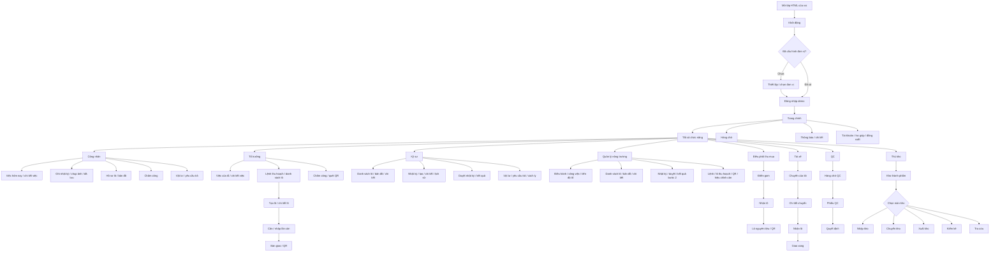
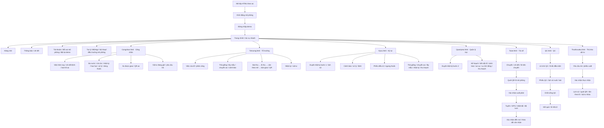

# Sơ đồ luồng màn hình prototype

Sơ đồ tập trung vào chuyển màn hình, không khẳng định các vai tạo thành một ứng dụng backend thống nhất. Tên vai/tệp trong sơ đồ được đối chiếu với các HTML hiện có trong workspace.

## 1. Mobile Trồng trọt

### Nhóm tệp vai

| Vai | Tệp |
|---|---|
| Công nhân | `Mobile_TrongTrot/CongNhan.html` |
| Tổ trưởng | `Mobile_TrongTrot/ToTruong.html` |
| Kỹ sư | `Mobile_TrongTrot/KySu.html` |
| Quản lý nông trường | `Mobile_TrongTrot/QuanLyNongTruong.html` |
| Điều phối thu mua | `Mobile_TrongTrot/DieuPhoiThuMua.html` |
| Tài xế | `Mobile_TrongTrot/TaiXe.html` |
| QC | `Mobile_TrongTrot/QC.html` |
| Thủ kho | `Mobile_TrongTrot/ThuKho.html` |

Từng tệp đóng gói màn hình theo một vai và có bộ điều hướng/quyền riêng. “Tất cả chức năng” là danh mục trong tệp vai, không phải menu cấp phép từ một máy chủ.

## 2. Mobile Thủy sản

### Tệp vai

`Mobile_ThuySan/Congnhan.html`, `Totruong.html`, `Kysu.html`, `Quanlytrai.html`, `Taixe.html`, `QC.html` và `Thukhovattu.html`.

Các trang nghiệp vụ mở từ Trang chính/tác vụ nhanh; thanh điều hướng chung dẫn tới Trang chính, Hàng chờ, Thông báo và Tài khoản. Trợ lý hội thoại là mô phỏng, không kết nối AI/micro thật.

## 3. Ghi chú khi dùng sơ đồ

- Màn hình dùng chung về mặt tên (ví dụ đăng nhập, hàng chờ) không có nghĩa dùng chung tài khoản, backend hoặc giao dịch.
- Luồng Trồng trọt giữa các vai là sơ đồ màn hình tham khảo; mỗi vai lưu mock state riêng.
- Thủy sản dùng cùng khóa localStorage giữa các tệp, nhưng chỉ những collection được cập nhật/đọc tương ứng mới phản ánh dữ liệu qua vai. Các đường bàn giao chưa nối được ghi rõ trong [sơ đồ nghiệp vụ](so-do-luong-nghiep-vu.md).
- Tài liệu AgriOS liên quan trong `D:\Project\agrios-main\agrios-main` được dùng để đối chiếu phạm vi dự kiến; danh mục màn hình ở đây lấy từ prototype hiện có, không lấy chức năng chỉ xuất hiện trong SOW/SRS.
