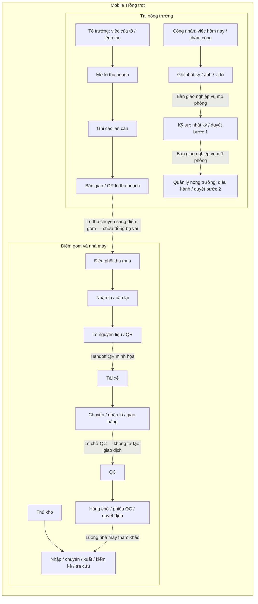
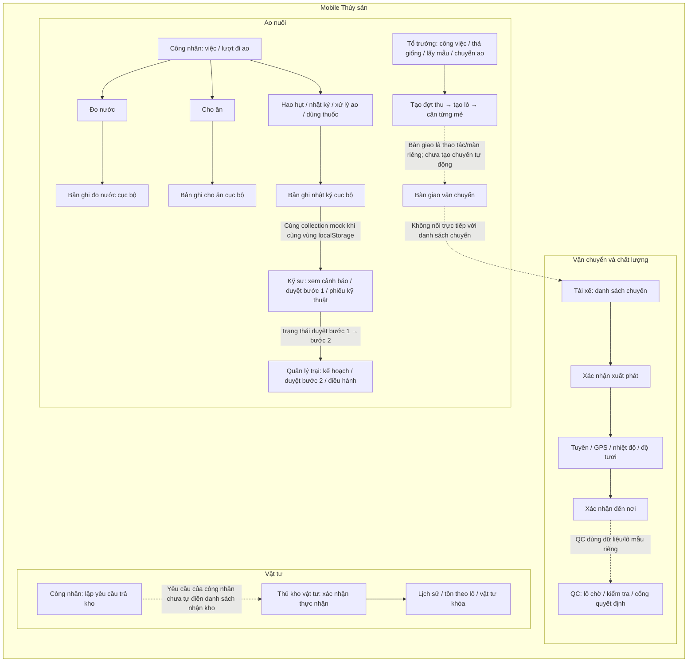

# Sơ đồ luồng nghiệp vụ prototype

> Tài liệu mô tả những luồng có màn hình hoặc tương tác trong prototype ở workspace này. Đây không phải đặc tả hệ thống sản xuất. Tài liệu AgriOS được dùng để đối chiếu bối cảnh, không dùng để suy rộng chức năng chưa có trong prototype.

## Quy ước

- Mũi tên liền: các bước hoặc dữ liệu được xử lý trong cùng prototype/nhóm màn hình.
- Mũi tên nét đứt: bàn giao nghiệp vụ giữa các vai để tham khảo; không hàm ý giao dịch đã liên thông.
- Nội dung có nhãn **mô phỏng** dùng dữ liệu giả lập hoặc thao tác cục bộ.

## 1. Trồng trọt

### Cách đọc và giới hạn

- Các màn hình tiêu biểu gồm: nhật ký và chấm công của Công nhân; lệnh/thu hoạch/cân/bàn giao của Tổ trưởng; duyệt nhật ký của Kỹ sư và Quản lý; nhận lô của Điều phối thu mua; chuyến của Tài xế; hàng chờ và quyết định QC; các thao tác kho.
- Mỗi tệp vai Trồng trọt có vùng mock data riêng (ví dụ `vbdagri.crop.worker.mock.v4`, `vbdagri.crop.driver.mock.v4`). Vì vậy, các mũi tên giữa vai chỉ mô tả chuỗi nghiệp vụ để tham khảo; không khẳng định một bản ghi do vai trước tạo sẽ xuất hiện ở vai sau.
- Các màn hình tài xế, thu mua, QC và kho có luồng riêng để trình diễn. Việc cùng xuất hiện trong prototype không đồng nghĩa chúng trao đổi giao dịch thật.
- QR, dữ liệu bản đồ/GPS và một số thông tin thiết bị là thành phần mô phỏng; không có backend hoặc tích hợp thiết bị production.

## 2. Thủy sản

### Cách đọc và giới hạn

- Bảy tệp vai dùng chung khóa `vbdagri.aqua.demo.v1`. Những collection được cập nhật và đọc cùng tên (đáng chú ý là `diaries`, `measurements`, `feedings`, `harvest`, `weighings`, `trips`, `qcLots`) có thể phản ánh thay đổi mock giữa các vai khi trình duyệt cho phép các tệp dùng chung vùng lưu trữ. Đo nước, cho ăn và nhật ký/hao hụt là các collection riêng, không phải một luồng ghi duy nhất.
- Đây vẫn là trạng thái localStorage, không phải đồng bộ server. Một số thao tác có biểu mẫu/thông báo thành công nhưng chưa cập nhật collection mà vai khác đọc: ví dụ phân công không tự tạo việc cho Công nhân; bàn giao lô không tự tạo chuyến; yêu cầu trả của Công nhân không tự thành yêu cầu trong hàng chờ Thủ kho.
- Kỹ sư duyệt nhật ký bước 1 và Quản lý trại duyệt bước 2 có trạng thái mock nối tiếp trong collection nhật ký. Không suy rộng điều này thành workflow backend hoặc phê duyệt production.
- QC có kiểm tra điều kiện cân nhận và các quyết định `RELEASE / HOLD / REJECT / REPROCESS`; dữ liệu lô QC là dữ liệu mẫu của prototype, không phải cổng chất lượng nhà máy thật.
- Camera/QR, trợ lý AI, GPS và thao tác đồng bộ đều thuộc phạm vi mô phỏng; không kết nối dịch vụ bên ngoài.

## 3. Đối chiếu tài liệu AgriOS

Các nguồn ở `D:\Project\agrios-main\agrios-main` được dùng làm bối cảnh tham khảo: tổng quan vai và tính năng Mobile Trồng trọt; tài liệu Mobile Thủy sản; SOW/demo plan Thủy sản; mockup Trồng trọt; SRS của hai ngành. Một số nguồn là bản nháp/đề xuất. Khi nội dung tài liệu tham chiếu rộng hơn giao diện/hành vi nhìn thấy trong prototype, sơ đồ này chỉ ghi phần có bằng chứng trong prototype và nêu giới hạn, không coi phần còn lại là chức năng đã triển khai.

## Nguồn trong workspace

- [README và giới hạn prototype](../README.md)
- [Prototype Trồng trọt](../Mobile_TrongTrot/)
- [Prototype Thủy sản](../Mobile_ThuySan/)
