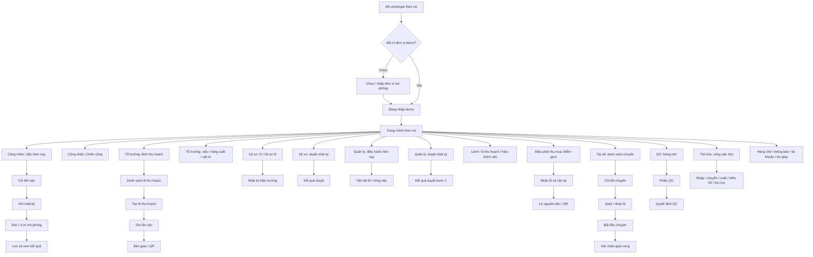
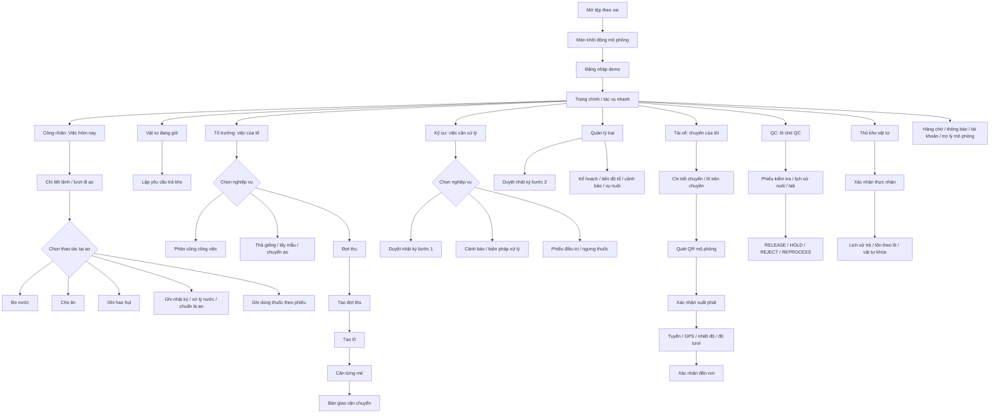

# Userflow prototype Mobile

Các hành trình dưới đây tập trung vào mục tiêu của người dùng và những màn hình có trong từng tệp HTML. “Lưu”, “duyệt”, “nhận” hoặc “đồng bộ” trong sơ đồ là thao tác mô phỏng bằng dữ liệu cục bộ, trừ khi được ghi rõ khác.

## 1. Trồng trọt

| Vai | Mục tiêu/hành trình chính trong prototype |
|---|---|
| Công nhân | Xem việc, mở chi tiết, ghi nhật ký và ảnh; xem chấm công, năng suất, vật tư theo màn hình được cấp. |
| Tổ trưởng | Theo dõi việc của tổ; đi vào luồng lô thu hoạch, cân, bàn giao/QR; có màn chấm công hỗ trợ. |
| Kỹ sư | Tra cứu lô; tạo/xem nhật ký và xử lý duyệt nhật ký bước 1. |
| Quản lý nông trường | Xem điều hành, tiến độ và lô; duyệt bước 2; xem lệnh thu hoạch và thao tác cân dành cho quản lý. |
| Điều phối thu mua | Mở Điểm gom, nhận lô, cân lại và xem lô nguyên liệu/QR. |
| Tài xế | Xem chuyến, nhận lô, bắt đầu chuyến và xác nhận giao xong. |
| QC | Mở hàng chờ, nhập phiếu và chọn quyết định QC. |
| Thủ kho | Mở Kho thành phẩm để nhập, chuyển, xuất, kiểm kê hoặc tra cứu. |

**Giới hạn liên vai:** các tệp Trồng trọt có mock store riêng theo vai. Các hành trình ở hàng khác nhau là user journey song song để tham khảo, không phải bằng chứng dữ liệu tự truyền từ vai này sang vai kia.

## 2. Thủy sản

| Vai | Mục tiêu/hành trình chính trong prototype |
|---|---|
| Công nhân | Xem việc và ao; ghi đo nước, cho ăn, hao hụt, nhật ký, xử lý ao/thuốc; xem vật tư và tạo yêu cầu trả. |
| Tổ trưởng | Theo dõi việc; dùng các biểu mẫu phân công, thả giống, lấy mẫu, chuyển ao; tạo đợt/lô thu, cân và mở màn bàn giao. |
| Kỹ sư | Duyệt nhật ký bước 1; xem cảnh báo; mở biểu mẫu lệnh xử lý, phiếu điều trị, thả giống/chuyển ao/lấy mẫu. |
| Quản lý trại | Duyệt nhật ký bước 2; xem kế hoạch, tiến độ tổ, cảnh báo, ao/vụ và thu hoạch. |
| Tài xế | Xem chuyến; quét mã minh họa; ghi xuất phát/đến nơi và xem tuyến, GPS, nhiệt độ, độ tươi. |
| QC | Chọn lô, nhập kiểm tra, xem trạng thái lab và chọn quyết định cổng QC. |
| Thủ kho vật tư | Mở yêu cầu trả, xác nhận số thực nhận/lý do chênh lệch; xem tồn kho và lịch sử. |

**Giới hạn liên vai:** các tệp Thủy sản dùng chung khóa localStorage `vbdagri.aqua.demo.v1`, nên một số bản ghi mock có thể được vai khác đọc trong cùng vùng lưu trữ trình duyệt. Tuy vậy, các thao tác phân công, bàn giao vận chuyển và yêu cầu trả kho chưa tạo đúng bản ghi mà vai nhận đọc; không nên coi các đường nối đó là giao dịch liên thông.

## Điều hướng chung

- Trồng trọt: vào tệp HTML của vai; sau khi qua màn thiết lập/đăng nhập demo, Trang chính và “Tất cả chức năng” là điểm vào các màn nghiệp vụ; Hàng chờ, thông báo, tài khoản và trợ giúp là các nhánh tiện ích.
- Thủy sản: vào tệp HTML của vai; đăng nhập demo đưa tới Trang chính. Thanh điều hướng chung gồm Trang chính, Hàng chờ, Thông báo, Tài khoản; các nghiệp vụ theo vai mở từ tác vụ nhanh/danh sách trong Trang chính. Trợ lý và micro được mô phỏng.
